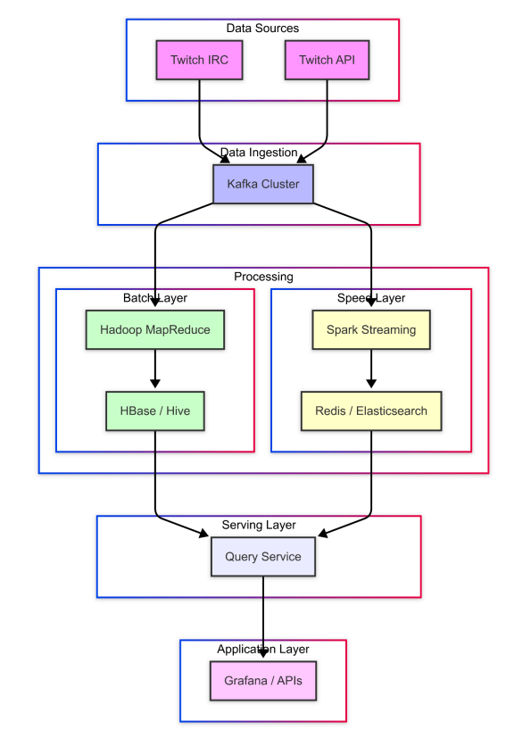

# TwitchStream Analytics : Big Data Project

A real-time big data processing pipeline that ingests Twitch streams and games data, processes it with Apache Spark, and stores it in both HDFS and Elasticsearch for analytics and visualization.

## Architecture Overview



## Components

### Data Producers
- **Twitch Stream Producer**: Fetches live stream data from Twitch API every minute
- **Twitch Games Producer**: Fetches top games data from Twitch API every hour

### Message Queue
- **Apache Kafka**: Handles real-time data streaming with topics:
  - `twitch_streams`: Live stream data
  - `twitch_games`: Top games data

### Processing Engine
- **Apache Spark**: Processes streaming data with two jobs:
  - **HDFS Job**: Raw data storage for batch processing
  - **Elasticsearch Job**: Real-time data processing and indexing

### Storage Solutions
- **HDFS**: Distributed storage for raw data and batch processing
- **Elasticsearch**: Search and analytics engine for processed data

### Monitoring & Visualization
- **Kafka UI**: Monitor Kafka topics and messages
- **Kibana**: Data visualization and dashboard creation
- **Hadoop Web UI**: HDFS cluster monitoring

## Quick Start

### Prerequisites
- Docker and Docker Compose
- Twitch API credentials (Client ID and OAuth Token)

### Setup

1. **Clone the repository**
   ```bash
   git clone <repository-url>
   cd twitch-big-data-pipeline
   ```

2. **Configure Twitch API credentials**
   
   Copy the example environment file and add your credentials:
   ```bash
   cp .env.example .env
   ```
   
   Edit the `.env` file with your Twitch API credentials:
   ```bash
   # Twitch API Credentials
   TWITCH_CLIENT_ID=your_actual_client_id_here
   TWITCH_OAUTH_TOKEN=your_actual_oauth_token_here
   
   # Kafka Configuration (default values, usually no need to change)
   KAFKA_BROKER=kafka:9092
   TWITCH_STREAMS_TOPIC=twitch_streams
   TWITCH_GAMES_TOPIC=twitch_games
   ```

3. **Start the pipeline**
   ```bash
   docker-compose up -d
   ```

4. **Verify services are running**
   ```bash
   docker-compose ps
   ```

### Getting Twitch API Credentials

1. Go to [Twitch Developer Console](https://dev.twitch.tv/console)
2. Create a new application
3. Note down your Client ID
4. Generate an OAuth token using the [Twitch OAuth Generator](https://twitchtokengenerator.com/)

## Data Flow

### 1. Data Ingestion
- **Streams**: Fetches top 20 live streams every 60 seconds
- **Games**: Fetches top 20 games every 3600 seconds (1 hour)

### 2. Data Processing
- **Raw Storage**: All data stored in HDFS as JSON for batch processing
- **Real-time Processing**: Data is cleaned, enriched, and indexed in Elasticsearch

### 3. Data Schema

#### Twitch Streams
```json
{
  "id": "stream_id",
  "user_id": "user_id", 
  "user_name": "streamer_name",
  "game_name": "game_title",
  "title": "stream_title",
  "viewer_count": 1500,
  "started_at": "2023-01-01T12:00:00Z",
  "language": "en",
  "is_mature": false
}
```

#### Twitch Games
```json
{
  "id": "game_id",
  "name": "game_name"
}
```

## Monitoring & Debugging

### Access Web Interfaces

- **Kafka UI**: http://localhost:8085
- **Spark Master**: http://localhost:8080
- **HDFS NameNode**: http://localhost:9871
- **Kibana**: http://localhost:5601
- **Elasticsearch**: http://localhost:9200

### Useful Commands

```bash
# Check service logs
docker-compose logs -f [service-name]

# Check Kafka topics
docker exec -it kafka kafka-topics --bootstrap-server localhost:9092 --list

# Check HDFS files
docker exec -it namenode hdfs dfs -ls /data/raw_twitch_streams

# Check Elasticsearch indices
curl http://localhost:9200/_cat/indices?v
```

## License

This project is licensed under the Apache License 2.0 - see the [LICENSE](LICENSE) file for details.

## Contributing

1. Fork the repository
2. Create a feature branch
3. Make your changes
4. Add tests if applicable
5. Submit a pull request

## Additional Resources

- [Twitch API Documentation](https://dev.twitch.tv/docs/api/)
- [Apache Kafka Documentation](https://kafka.apache.org/documentation/)
- [Apache Spark Streaming Guide](https://spark.apache.org/docs/latest/streaming-programming-guide.html)
- [Elasticsearch Documentation](https://www.elastic.co/guide/)
- [Docker Compose Reference](https://docs.docker.com/compose/)